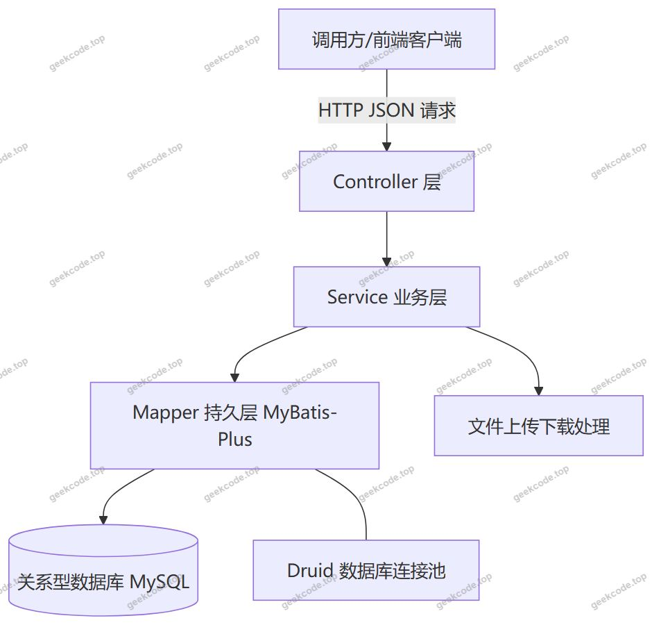
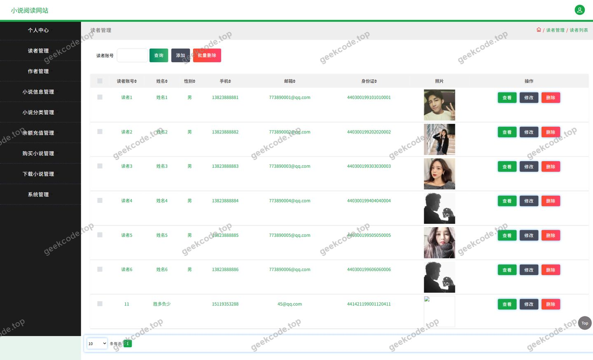
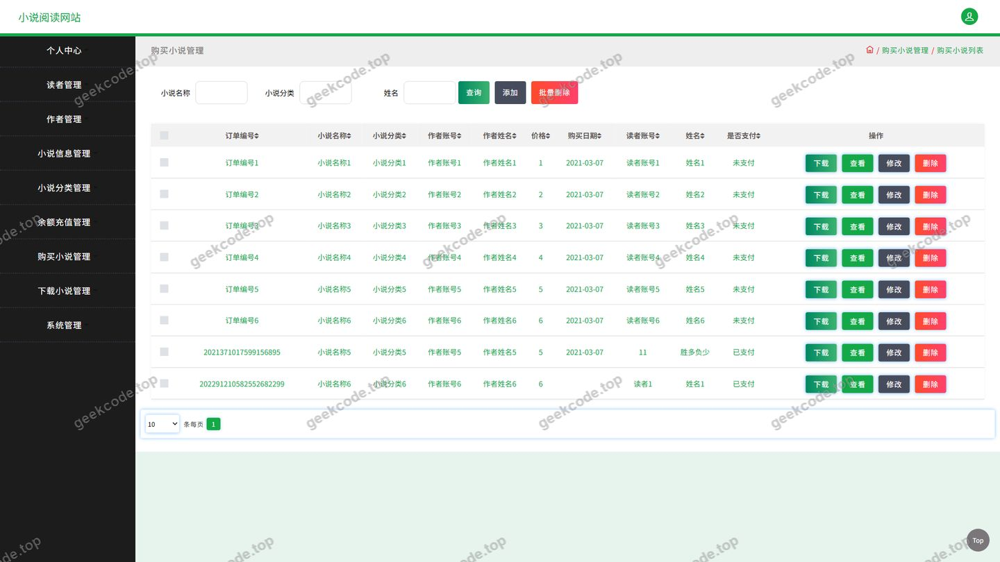
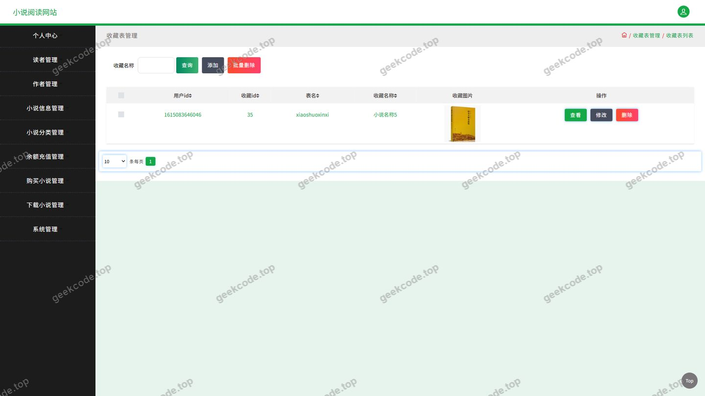
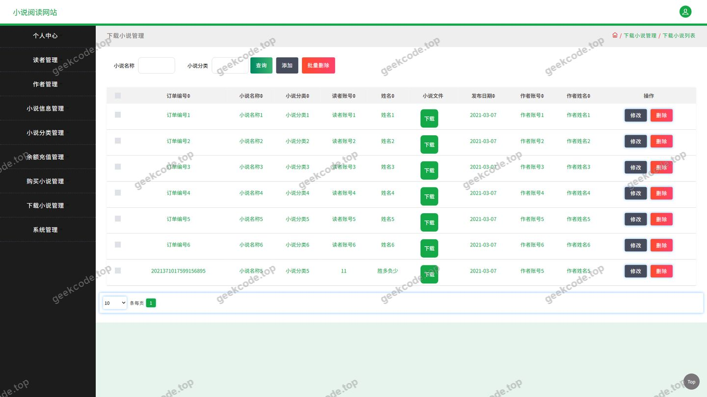
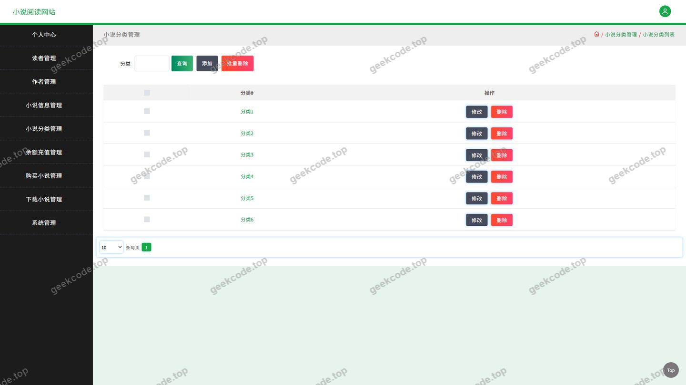
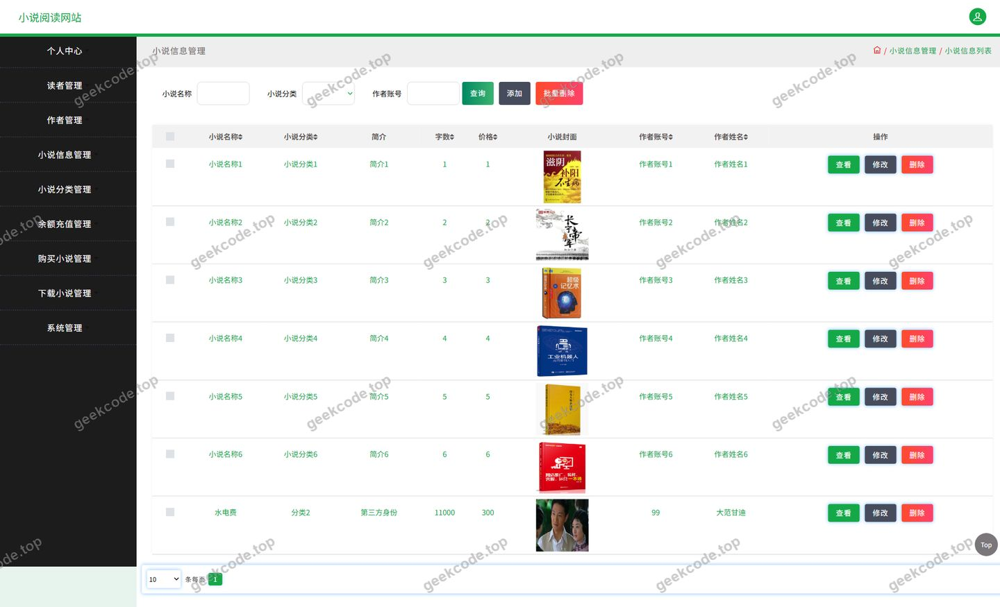
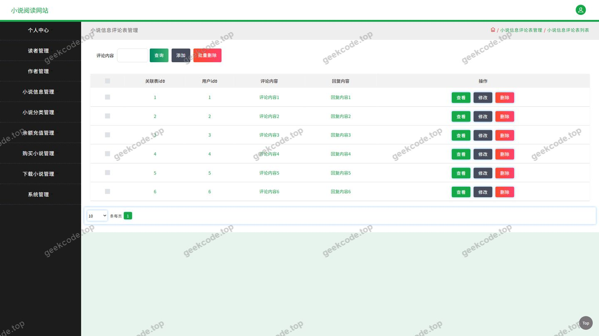
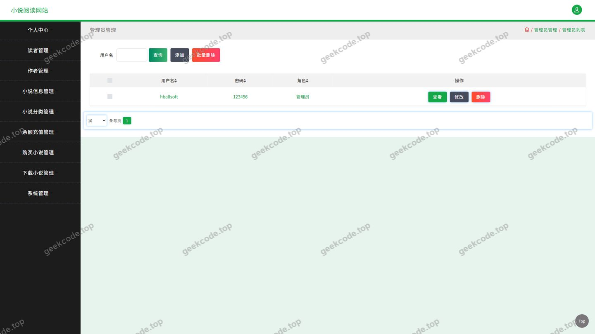

# java项目小说阅读网站java毕业设计

> 🎓 **计算机毕业设计 · java项目小说阅读网站java毕业设计**
>
> 本仓库只放**项目介绍 + 运行截图**（截图是站点带水印的原图，存在仓库 `images/` 里）。
>
> 👉 **完整可运行源码 / 数据库脚本 / 部署文档：[点我获取](https://geekcode.top/archives/java%E9%A1%B9%E7%9B%AE%E5%B0%8F%E8%AF%B4%E9%98%85%E8%AF%BB%E7%BD%91%E7%AB%99java%E6%AF%95%E4%B8%9A%E8%AE%BE%E8%AE%A1?utm_source=github)**
>
> 💬 咨询微信：**ir9372**　|　🌐 更多项目：[极客代码 geekcode.top](https://geekcode.top/?utm_source=github)
>
> 📌 项目详情页：<https://geekcode.top/archives/java%E9%A1%B9%E7%9B%AE%E5%B0%8F%E8%AF%B4%E9%98%85%E8%AF%BB%E7%BD%91%E7%AB%99java%E6%AF%95%E4%B8%9A%E8%AE%BE%E8%AE%A1?utm_source=github>

<table><td width="230" align="center"> <b>扫码加微信 ir9372</b></td><td valign="middle">📦 源码 = 项目介绍 + 全部运行截图 + 数据库 + 部署文档 👉 点上方任意截图，直接跳到 <b>极客代码 geekcode.top</b> 详情页</td></table>

---

<h1>java项目_小说阅读网站_java毕业设计</h1>
<h2>项目概述</h2>

本项目是一个基于 Java 后端技术栈开发的<strong>小说阅读网站服务端系统</strong>，采用纯 API 架构（pure-api），仅对外提供 HTTP 接口，不包含页面渲染层。项目围绕&quot;小说阅读&quot;这一核心业务，构建了从小说分类、小说信息维护，到读者浏览、评论互动、收藏、购买、下载，再到账户充值与后台用户管理的完整业务闭环。

核心功能包括：小说分类与小说信息的管理、读者对小说的评论交流、小说收藏、付费购买、资源下载、余额充值，以及用户、读者、系统配置与文件上传下载等支撑功能。

适用场景：可直接作为小说阅读类 Web 站点或移动端应用的后端服务，也可作为教学与毕业设计参考，用于演示 Spring 生态下的分层架构设计、MyBatis-Plus 数据持久化实践以及 REST 接口的规范化组织。

技术架构上，项目以 Spring 容器为核心，通过 spring-web/spring-webmvc 提供 Web 层能力，spring-tx 与 spring-aop 支撑事务与切面，spring-jdbc 结合 <strong>Druid 连接池</strong>进行数据源管理，持久层采用 <strong>MyBatis-Plus</strong> 简化 CRUD 操作，测试环节使用 JUnit。

<h2>技术架构</h2>
<h3>整体架构</h3>

项目采用经典的<strong>分层 MVC 架构</strong>，各层职责清晰、依赖单向：

<ul>
<li><strong>接口层（Controller）</strong>：由 12 个控制器组成，按业务实体划分职责边界，负责请求参数接收、结果封装与响应输出，不承载业务逻辑。</li>
<li><strong>业务层（Service）</strong>：承载评论、购买、收藏、充值等业务规则，通过 spring-tx 的声明式事务保证跨表操作的一致性（如购买小说时涉及订单记录与账户余额的同时变更）。</li>
<li><strong>持久层（Mapper）</strong>：基于 MyBatis-Plus 的通用 Mapper 能力完成单表 CRUD 与条件查询，减少 XML 样板代码。</li>
<li><strong>数据源层</strong>：使用 Druid 作为数据库连接池，负责连接复用、SQL 执行监控与性能统计。</li>
</ul>
<h3>控制器职责划分</h3>
<table>
<thead>
<tr>
<th>控制器</th>
<th>业务归属</th>
</tr>
</thead>
<tbody><tr>
<td><code>XiaoshuofenleiController</code></td>
<td>小说分类管理</td>
</tr>
<tr>
<td><code>XiaoshuoxinxiController</code></td>
<td>小说信息管理</td>
</tr>
<tr>
<td><code>DiscussxiaoshuoxinxiController</code></td>
<td>小说信息评论</td>
</tr>
<tr>
<td><code>DuzheController</code></td>
<td>读者信息管理</td>
</tr>
<tr>
<td><code>UserController</code></td>
<td>用户账号管理</td>
</tr>
<tr>
<td><code>StoreupController</code></td>
<td>收藏记录</td>
</tr>
<tr>
<td><code>GoumaixiaoshuoController</code></td>
<td>小说购买</td>
</tr>
<tr>
<td><code>XiazaixiaoshuoController</code></td>
<td>小说下载</td>
</tr>
<tr>
<td><code>YuechongzhiController</code></td>
<td>余额充值</td>
</tr>
<tr>
<td><code>FileController</code></td>
<td>文件上传与访问</td>
</tr>
<tr>
<td><code>ConfigController</code></td>
<td>系统配置</td>
</tr>
<tr>
<td><code>CommonController</code></td>
<td>通用公共接口</td>
</tr>
</tbody></table>
<h3>数据库设计要点</h3>

数据库按&quot;业务实体一表一职责&quot;的原则组织，主要数据集合包括：用户表、读者表、小说分类表、小说信息表、评论表、收藏表、购买记录表、下载记录表、充值记录表、系统配置表以及文件资源表。设计要点如下：

<ol>
<li><strong>实体对应关系</strong>：每张业务表与一个控制器形成对应关系，保证模块边界与数据边界一致。</li>
<li><strong>分类与内容的主从关系</strong>：小说分类作为小说信息的上层维度，小说信息通过分类标识关联，支持按分类聚合展示。</li>
<li><strong>行为记录类表</strong>：评论、收藏、购买、下载、充值均属于&quot;用户—资源—行为&quot;型记录，通过关联用户标识与小说标识建立多对多联系，便于统计与个人中心数据聚合。</li>
<li><strong>公共字段规范</strong>：业务表统一使用自增主键标识，并配置创建时间等通用字段，配合 MyBatis-Plus 的通用字段策略完成自动填充。</li>
<li><strong>文件与业务分离</strong>：小说封面、下载资源等文件由文件模块统一处理，业务表仅保存文件访问地址。</li>
</ol>
<h3>核心技术选型理由</h3>
<ul>
<li><strong>MyBatis-Plus</strong>：在 MyBatis 之上提供通用 Mapper、条件构造器与分页能力，小说分类、小说信息、评论、收藏等模块的查询条件组合频繁，使用条件构造器可显著降低 SQL 维护成本；同时保留原生 SQL 能力，便于复杂统计查询。</li>
<li><strong>Druid</strong>：提供连接池管理、慢 SQL 记录与内置监控能力，适合并发访问较集中的小说浏览与下载场景。</li>
<li><strong>Spring 生态组合（spring-core / context / beans / aop / tx / jdbc / web / webmvc）</strong>：以 IoC 容器统一管理 Bean 生命周期，以 AOP 实现横切逻辑复用，以声明式事务保障购买、充值等资金相关流程的数据一致性，整体技术栈轻量、成熟、可维护。</li>
<li><strong>JUnit</strong>：用于服务层与接口层的单元测试，保障核心业务逻辑的可回归验证。</li>
</ul>
<h2>功能模块</h2>
<h3>前台用户端模块</h3>
<table>
<thead>
<tr>
<th>模块</th>
<th>对应控制器</th>
<th>功能描述</th>
</tr>
</thead>
<tbody><tr>
<td>登录</td>
<td>—</td>
<td>提供账号登录入口，校验身份后进入系统使用各项业务功能。</td>
</tr>
<tr>
<td>小说分类</td>
<td><code>XiaoshuofenleiController</code></td>
<td>展示与查询小说分类信息，作为小说检索与分类浏览的入口。</td>
</tr>
<tr>
<td>小说信息</td>
<td><code>XiaoshuoxinxiController</code></td>
<td>提供小说信息的列表、详情与条件查询，包含小说基础信息与封面等内容。</td>
</tr>
<tr>
<td>小说信息评论</td>
<td><code>DiscussxiaoshuoxinxiController</code></td>
<td>读者针对具体小说发表评论并查看评论内容，形成互动交流区。</td>
</tr>
<tr>
<td>收藏</td>
<td><code>StoreupController</code></td>
<td>读者收藏感兴趣的小说，支持收藏记录的添加、取消与查询。</td>
</tr>
<tr>
<td>我的收藏</td>
<td><code>StoreupController</code></td>
<td>在个人中心集中查看本人已收藏的小说清单。</td>
</tr>
<tr>
<td>购买小说</td>
<td><code>GoumaixiaoshuoController</code></td>
<td>读者对小说发起购买，生成购买记录并关联账户消费。</td>
</tr>
<tr>
<td>下载小说</td>
<td><code>XiazaixiaoshuoController</code></td>
<td>记录并处理小说资源的下载请求，形成下载记录。</td>
</tr>
<tr>
<td>余额充值</td>
<td><code>YuechongzhiController</code></td>
<td>为账户余额充值，生成充值记录，为付费购买提供资金支持。</td>
</tr>
<tr>
<td>个人中心</td>
<td><code>UserController</code> / <code>DuzheController</code></td>
<td>查看与维护个人账号资料。</td>
</tr>
<tr>
<td>文件访问</td>
<td><code>FileController</code></td>
<td>上传与获取小说封面、资源文件等静态内容。</td>
</tr>
</tbody></table>
<h3>后台管理端模块</h3>
<table>
<thead>
<tr>
<th>模块</th>
<th>对应控制器</th>
<th>功能描述</th>
</tr>
</thead>
<tbody><tr>
<td>用户管理</td>
<td><code>UserController</code></td>
<td>维护系统用户账号信息，支持查询与增删改等管理操作。</td>
</tr>
<tr>
<td>读者管理</td>
<td><code>DuzheController</code></td>
<td>维护读者档案信息，管理读者基础数据。</td>
</tr>
<tr>
<td>小说分类管理</td>
<td><code>XiaoshuofenleiController</code></td>
<td>新增、修改、删除小说分类，维护分类体系。</td>
</tr>
<tr>
<td>小说信息管理</td>
<td><code>XiaoshuoxinxiController</code></td>
<td>发布与维护小说信息，管理小说基础数据与展示内容。</td>
</tr>
<tr>
<td>评论管理</td>
<td><code>DiscussxiaoshuoxinxiController</code></td>
<td>查看与管理小说评论内容，维护互动区秩序。</td>
</tr>
<tr>
<td>收藏管理</td>
<td><code>StoreupController</code></td>
<td>查看全站收藏记录，掌握用户收藏行为数据。</td>
</tr>
<tr>
<td>购买记录管理</td>
<td><code>GoumaixiaoshuoController</code></td>
<td>查看与管理小说购买记录。</td>
</tr>
<tr>
<td>下载记录管理</td>
<td><code>XiazaixiaoshuoController</code></td>
<td>查看与管理小说下载记录。</td>
</tr>
<tr>
<td>充值记录管理</td>
<td><code>YuechongzhiController</code></td>
<td>查看与管理用户充值记录。</td>
</tr>
<tr>
<td>文件管理</td>
<td><code>FileController</code></td>
<td>统一处理文件上传与资源访问。</td>
</tr>
<tr>
<td>系统配置</td>
<td><code>ConfigController</code></td>
<td>维护系统级配置参数，供各业务模块读取使用。</td>
</tr>
<tr>
<td>公共接口</td>
<td><code>CommonController</code></td>
<td>提供跨模块共用的通用能力接口。</td>
</tr>
</tbody></table>
<h2>用户角色与权限</h2>

系统在账号层面划分为 <strong>用户（User）</strong> 与 <strong>读者（Duzhe）</strong> 两类实体，并结合管理职能形成两类使用角色：

<h3>管理员</h3>

面向系统运营与数据维护，可访问全部管理类接口，具体包括：

<ul>
<li>用户管理：查询、新增、修改、删除系统用户账号。</li>
<li>读者管理：查询与维护读者档案信息。</li>
<li>小说分类管理：分类的新增、编辑、删除与查询。</li>
<li>小说信息管理：小说内容的上架、编辑、下架与查询。</li>
<li>评论管理：查看、审核与删除小说评论。</li>
<li>收藏管理：查看全站收藏记录。</li>
<li>购买记录管理：查看并管理小说购买流水。</li>
<li>下载记录管理：查看并管理小说下载流水。</li>
<li>充值记录管理：查看并管理用户充值流水。</li>
<li>文件管理：上传文件、维护资源访问地址。</li>
<li>系统配置：修改系统级配置项。</li>
<li>公共接口：调用系统通用能力接口。</li>
</ul>
<h3>读者 / 用户</h3>

面向小说阅读与消费，可访问前台业务接口，具体包括：

<ul>
<li>登录：使用账号登录系统。</li>
<li>小说浏览：查询小说分类、浏览小说列表与小说详情。</li>
<li>评论互动：对小说发表评论、查看评论列表。</li>
<li>收藏：收藏小说、取消收藏、查看&quot;我的收藏&quot;。</li>
<li>购买：对小说发起购买并查看购买记录。</li>
<li>下载：发起小说资源下载并查看下载记录。</li>
<li>充值：为账户余额充值并查看充值记录。</li>
<li>个人中心：查看与修改本人账号资料。</li>
<li>文件访问：获取小说封面与相关资源文件。</li>
</ul>
<h2>项目特色与创新点</h2>
<ol>
<li>
<strong>完整的小说阅读业务闭环</strong>：将&quot;分类—内容—互动—收藏—付费—下载—充值&quot;串联为一条完整链路，而非孤立的功能堆砌。小说分类与小说信息构成内容主干，评论与收藏承担互动与留存，购买、充值、下载构成消费与交付环节，各环节通过统一的用户标识打通。

</li>
<li>
<strong>纯 API 架构带来的多端复用能力</strong>：项目不绑定任何页面渲染技术，接口以标准 HTTP 形式对外提供服务，同一套后端可同时支撑 Web 站点、移动端或小程序等多种前端形态，降低了多端重复开发的成本。

</li>
<li>
<strong>MyBatis-Plus 与 Druid 的协同增效</strong>：MyBatis-Plus 的条件构造器与通用 Mapper 显著压缩了持久层代码量，使开发重心回归业务规则；Druid 提供连接池监控与 SQL 执行数据，为小说浏览、下载等高频访问场景的性能观察与调优提供了直接依据。

</li>
<li>
<strong>按业务实体切分的控制器边界</strong>：每个控制器对应一个明确的业务实体（分类、小说、评论、收藏、购买、下载、充值、文件、配置），模块职责单一、耦合度低，便于独立演进与后期扩展，也使接口文档的组织天然清晰。

</li>
<li>
<strong>行为数据可沉淀</strong>：评论、收藏、购买、下载、充值均以记录形式持久化，为后续的阅读偏好分析、热门小说统计、内容运营决策提供了数据基础。

</li>
<li>
<strong>声明式事务保障关键流程一致性</strong>：借助 spring-tx，对购买、充值等涉及多表变更的操作进行事务控制，避免出现记录生成与状态变更不一致的问题。

</li>
</ol>
<h2>部署环境</h2>
<h3>软件环境</h3>
<table>
<thead>
<tr>
<th>类别</th>
<th>要求</th>
</tr>
</thead>
<tbody><tr>
<td>JDK</td>
<td>JDK 8 及以上版本（需与所选 Spring 框架版本匹配）</td>
</tr>
<tr>
<td>构建工具</td>
<td>Maven，用于依赖管理与项目打包</td>
</tr>
<tr>
<td>数据库</td>
<td>MySQL，通过 Druid 连接池接入</td>
</tr>
<tr>
<td>连接池</td>
<td>Druid</td>
</tr>
<tr>
<td>持久层框架</td>
<td>MyBatis-Plus</td>
</tr>
<tr>
<td>测试框架</td>
<td>JUnit</td>
</tr>
<tr>
<td>Web 容器</td>
<td>由 spring-web / spring-webmvc 提供 Web 能力，可运行于内置容器或独立 Servlet 容器</td>
</tr>
<tr>
<td>前端运行环境</td>
<td>本项目为纯 API 工程，服务端部署不依赖 Node.js；如需配合独立前端页面访问接口，需另行部署该前端工程</td>
</tr>
</tbody></table>
<h3>部署步骤要点</h3>
<ol>
<li>安装并启动 MySQL，创建项目所需数据库。</li>
<li>导入项目的建表脚本与初始数据（分类、小说信息、配置项等基础数据）。</li>
<li>修改数据源配置，填写数据库地址、端口、库名、账号与密码，并完成 Druid 连接池参数配置。</li>
<li>使用 Maven 执行依赖拉取与项目构建，生成可部署产物。</li>
<li>启动应用，确认接口服务正常对外提供访问。</li>
<li>通过接口调用完成登录验证，随后按角色分别验证前台业务接口与管理类接口的可用性。</li>
</ol>
<h2>五、技术特性</h2>
<ul>
<li>使用 MyBatis-Plus 简化数据访问层开发</li>
</ul>
<h2>六、功能模块截图</h2>
<h3>后台管理端</h3>
<h4>页面-登录</h4>

<h4>页面-读者</h4>

<h4>页面-购买小说</h4>

<h4>页面-收藏</h4>

<h4>页面-下载小说</h4>

<h4>页面-小说分类</h4>

<h4>页面-小说信息</h4>

<h4>页面-小说信息评论</h4>

<h4>页面-用户</h4>

---

## 获取完整源码

| 项目 | 说明 |
| --- | --- |
| 项目名 | java项目小说阅读网站java毕业设计 |
| 运行截图 | 本文 10 张（站点带水印原图，仓库 `images/` 目录） |
| 完整源码 | [https://geekcode.top/archives/java%E9%A1%B9%E7%9B%AE%E5%B0%8F%E8%AF%B4%E9%98%85%E8%AF%BB%E7%BD%91%E7%AB%99java%E6%AF%95%E4%B8%9A%E8%AE%BE%E8%AE%A1?utm_source=github](https://geekcode.top/archives/java%E9%A1%B9%E7%9B%AE%E5%B0%8F%E8%AF%B4%E9%98%85%E8%AF%BB%E7%BD%91%E7%AB%99java%E6%AF%95%E4%B8%9A%E8%AE%BE%E8%AE%A1?utm_source=github) |
| 咨询微信 | **ir9372**（备注：jingpin-yuanma） |
| 更多项目 | [极客代码 geekcode.top](https://geekcode.top/?utm_source=github) |

> 需要源码、部署、改配置、跑不起来等问题，加微信 ir9372 沟通，说明项目名即可。
